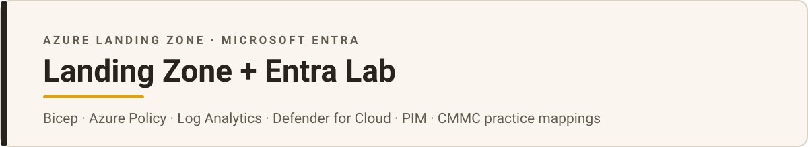
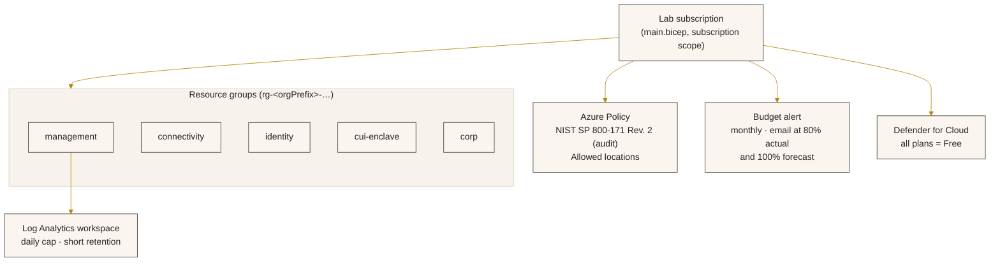

# 

<p>
  
  
  
  
  
</p>

A minimal Azure landing zone written in Bicep, plus a step-by-step Microsoft Entra lab guide, with CMMC practice mappings. Built as a **lab for learning**, using a fictional tenant ("Talvex").

> [!WARNING]
> **Lab, not production.** This is learning material. Do not deploy it to a production subscription or use it as-is for a real environment.

> [!CAUTION]
> **No CUI.** Nothing in this repo contains, or should be used with, Controlled Unclassified Information, real customer data, or real credentials.

<p align="center"></p>

## 🧩 What it deploys

The Bicep template (`infra/main.bicep`, subscription scope) creates:

- **Policy guardrails**: built-in Azure Policy assignments: the NIST SP 800-171 Rev. 2 initiative (audit-oriented) and Allowed locations
- **Log Analytics workspace with a daily cap**: low retention and a daily ingestion cap to keep lab costs down
- **Budget alert**: a monthly budget with email notifications
- **Defender for Cloud plans set to Free**: no paid Defender plans are enabled
- A set of resource groups following a simple platform / corp / enclave layout



## 📚 The lab guide

[`docs/Talvex_Landing_Zone_Lab_Guide.md`](docs/Talvex_Landing_Zone_Lab_Guide.md) is a portal-first walkthrough. Jump to a section:

| # | Section |
|---|---|
| 0 | [Overview: what you're building and why](docs/Talvex_Landing_Zone_Lab_Guide.md#section-0--overview-what-youre-building-and-why) |
| 1 | [Prerequisites](docs/Talvex_Landing_Zone_Lab_Guide.md#section-1--prerequisites-do-these-first-in-this-order) |
| 2 | [Management groups, subscription placement, naming and tags](docs/Talvex_Landing_Zone_Lab_Guide.md#section-2--management-group-hierarchy-subscription-placement-naming-and-tags) |
| 3 | [RBAC + PIM for Azure resources](docs/Talvex_Landing_Zone_Lab_Guide.md#section-3--rbac--pim-for-azure-resources-at-management-group-scope) |
| 4 | [Azure Policy guardrails](docs/Talvex_Landing_Zone_Lab_Guide.md#section-4--azure-policy-guardrails) |
| 5 | [Defender for Cloud: Foundational CSPM only](docs/Talvex_Landing_Zone_Lab_Guide.md#section-5--microsoft-defender-for-cloud-foundational-cspm-only) |
| 6 | [Central logging: Log Analytics, Activity Log, Sentinel](docs/Talvex_Landing_Zone_Lab_Guide.md#section-6--central-logging-log-analytics-activity-log-microsoft-sentinel-trial) |
| 7 | [Hub-and-spoke network](docs/Talvex_Landing_Zone_Lab_Guide.md#section-7--hub-and-spoke-network-no-gateways-no-firewall-no-vms) |
| 8 | [Validation and evidence pack (CMMC Level 2)](docs/Talvex_Landing_Zone_Lab_Guide.md#section-8--validation-and-evidence-pack-mapped-to-cmmc-level-2) |
| 9 | [Teardown checklist](docs/Talvex_Landing_Zone_Lab_Guide.md#section-9--teardown-checklist-do-this-before-day-30) |
| 10 | [Azure Government / GCC High: what changes](docs/Talvex_Landing_Zone_Lab_Guide.md#section-10--azure-government--gcc-high-what-changes-for-real-cmmc-customers) |
| 11 | [Next phase: IaC and a pipeline](docs/Talvex_Landing_Zone_Lab_Guide.md#section-11--next-phase-infrastructure-as-code-iac-and-a-pipeline-brief) |
| A | [Everything that can cost money](docs/Talvex_Landing_Zone_Lab_Guide.md#appendix-a--everything-in-this-lab-that-can-cost-money-and-how-to-avoid-it) |
| B | [What wasn't fully verified on Microsoft Learn](docs/Talvex_Landing_Zone_Lab_Guide.md#appendix-b--what-wasnt-fully-verified-on-microsoft-learn) |

## 📂 Repo layout

```
infra/
  main.bicep               # subscription-scope template
  main.bicepparam          # UNTESTED STARTER parameters (placeholders)
  main.parameters.json     # JSON equivalent of the starter parameters
  modules/log-analytics.bicep
docs/
  Talvex_Landing_Zone_Lab_Guide.md   # portal-first Entra / landing zone lab guide
```

<p align="center"></p>

## ✅ Prerequisites

- An Azure subscription you can safely experiment in (a free or throwaway lab subscription is ideal)
- Permission to deploy at subscription scope (e.g. Owner on the lab subscription)
- [Azure CLI](https://learn.microsoft.com/cli/azure/install-azure-cli) with Bicep (`az bicep install`)

## 🔧 Before you deploy: edit the parameters

> [!CAUTION]
> **`infra/main.bicepparam` is an UNTESTED STARTER.** It contains placeholders: `orgPrefix = 'contoso'` and `lab-owner@example.com` as the budget alert email. **You must edit these** (and review every other value) and **run a what-if** before any real deployment. The template has not been validated end to end against a live subscription.

## 🚀 Deploy

Always run **what-if first** and read the output:

```bash
cd infra
az login
az account set --subscription "<your-lab-subscription-id>"

# 1. Preview changes (nothing is created)
az deployment sub what-if \
  --location eastus2 \
  --template-file main.bicep \
  --parameters main.bicepparam

# 2. Only if the preview looks right:
az deployment sub create \
  --location eastus2 \
  --template-file main.bicep \
  --parameters main.bicepparam
```

<p align="center"></p>

## 💲 Cost note

The design aims for roughly **$0**: Defender plans are Free, the Log Analytics workspace has a daily cap and short retention, and a budget alert is included. **This is a design goal, not a guarantee.** Verify pricing in your own subscription, check the what-if output, watch the budget alert, and delete lab resources when finished. Note that a daily cap stops log ingestion once reached, which is acceptable in a lab but not in production.

## 🧾 CMMC mapping caveat

> [!IMPORTANT]
> The CMMC practice mappings in the lab guide were **written by the repo author** and are not an official or authoritative crosswalk. **Verify every mapping against official Microsoft documentation and the official CMMC / NIST sources** (CMMC Assessment Guide Level 2, NIST SP 800-171 Rev. 2) before relying on it. Nothing here is legal, compliance, or assessment advice.

## 📄 License

MIT. See [LICENSE](LICENSE).

<!-- pizzazz-recipe: {"pz":1,"kit":"my-color-profile","concept":"Spec Sheet","family":"refined","dev":{"intensity":"standard","flourish":"amber dividers","structure":"slim header"},"sig":"amber rule dividers","pal":{"pri":"#27241D","sec":"#423D33","tint":"#FAF5EE","zeb":"#F7F3EC","mut":"#625B50","ftr":"#6B6358","hair":"#D9D1C4","acc":"#D9A21B","watch":"#B44D12"},"font":{"h":"system-ui","b":"system-ui"},"date":"2026-11-19"} -->
