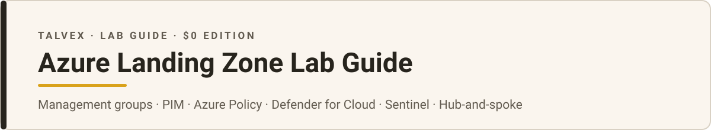
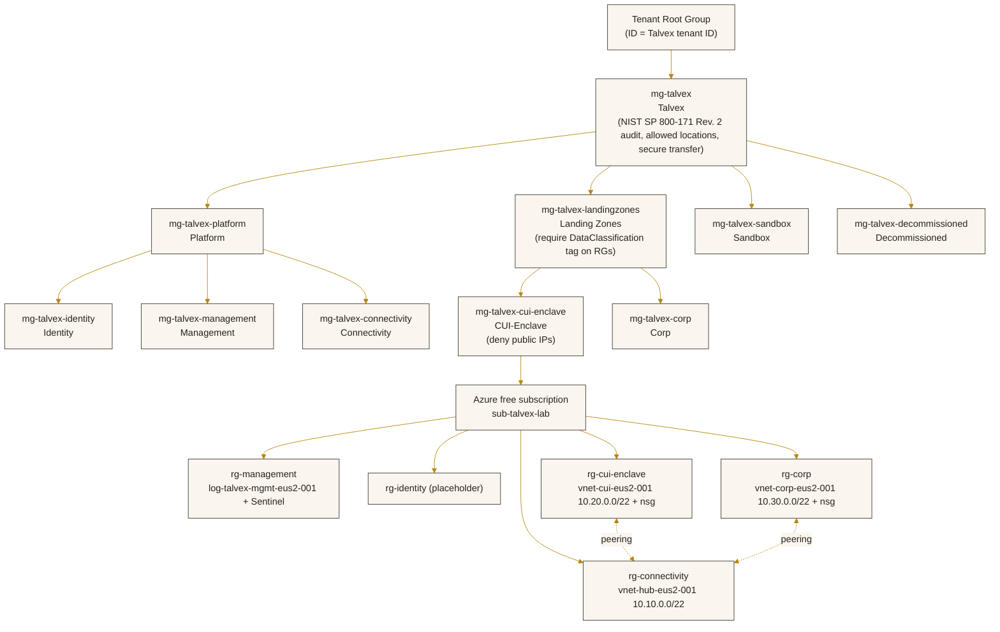

# 

**Lab tenant:** Talvex (a fictional manufacturer)
**Cloud:** Commercial Azure (the regular cloud, *not* Azure Government)
**Licensing:** Microsoft Entra ID P2 only
**Budget:** $0. Every step is either free or marked with a **💲 COST FLAG** that explains the charge and how to avoid it or delete it.
**Date:** October 19, 2026. Click-paths were checked against Microsoft Learn on this date. Portals change often, so if a blade looks different from what's described here, trust the Learn link for that section.

---

## How to read this guide

- **Click-paths** use the `>` symbol. For example, **Microsoft Entra ID > Manage > Properties** means: open Microsoft Entra ID, find the **Manage** group in the left menu, then select **Properties**.
- **Optional CLI/PowerShell** blocks show the same steps in Azure CLI (Azure Command-Line Interface) or Azure PowerShell. You don't have to run them. The portal path is the main lab.
  > 💲 **COST FLAG — Cloud Shell:** The classic Azure Cloud Shell setup creates a storage account, which costs a few cents a month. You can avoid it two ways. One is to run the CLI or PowerShell locally (`winget install Microsoft.AzureCLI`, `Install-Module Az`). The other is to pick Cloud Shell's **ephemeral session / no storage account** option if your portal offers it. *(That option wasn't re-checked on Learn for this guide.)*
- **"✅ Verified"** means the step was checked against the Microsoft Learn page cited in that section. **"⚠️ Unverified / partially verified"** means I couldn't fully confirm it on Learn. Treat those steps with a little suspicion.
- **CMMC mapping** uses the practice IDs from the CMMC Assessment Guide Level 2 from the public CMMC Assessment Guide Level 2.

### Acronyms (written out the first time they appear)

| Acronym | Meaning |
|---|---|
| ALZ | Azure Landing Zone |
| CAF | Microsoft Cloud Adoption Framework for Azure |
| CMMC | Cybersecurity Maturity Model Certification |
| CUI | Controlled Unclassified Information |
| NIST SP 800-171 | National Institute of Standards and Technology Special Publication 800-171 |
| MG | Management group |
| RG | Resource group |
| RBAC | Role-based access control |
| PIM | Microsoft Entra Privileged Identity Management |
| UAA | User Access Administrator (an Azure role) |
| MFA | Multifactor authentication |
| CSPM | Cloud Security Posture Management |
| MCSB | Microsoft Cloud Security Benchmark |
| DINE | DeployIfNotExists (an Azure Policy effect) |
| SIEM | Security Information and Event Management |
| KQL | Kusto Query Language |
| VNet | Azure Virtual Network |
| NSG | Network security group |
| CIDR | Classless Inter-Domain Routing (address notation like 10.20.0.0/22) |
| DDoS | Distributed Denial of Service |
| IaC | Infrastructure as Code |
| OIDC | OpenID Connect |
| GCC High | Microsoft 365 Government Community Cloud High |

---

## Section 0 — Overview: what you're building and why

### 0.1 What a "landing zone" is, in plain words

An **Azure landing zone** is the pre-built "foundation" of an Azure environment. It includes the folder structure (management groups), the guardrails (Azure Policy), the access model (RBAC and PIM), central logging, a network layout and a security baseline. All of it is in place *before* anyone deploys a workload. The Cloud Adoption Framework (CAF) separates two kinds of landing zone:

- **Platform landing zones** hold shared services that everyone uses: identity, management and logging, and connectivity (the hub network).
- **Application (workload) landing zones** are where workloads live. For Talvex, that's a **CUI-Enclave** for anything that touches CUI and a **Corp** zone for normal internal workloads.

In production, each of these is usually its **own subscription**. You have **one free subscription**, so this lab *simulates* the split:

| Real-world (multi-subscription) | This lab (one subscription) |
|---|---|
| Identity subscription under the Platform > Identity MG | `rg-identity` resource group (placeholder only) |
| Management subscription under the Platform > Management MG | `rg-management` (Log Analytics + Sentinel) |
| Connectivity subscription under the Platform > Connectivity MG | `rg-connectivity` (hub VNet) |
| CUI workload subscription(s) under Landing Zones > CUI-Enclave | `rg-cui-enclave` (CUI spoke VNet) |
| Corp workload subscription(s) under Landing Zones > Corp | `rg-corp` (Corp spoke VNet) |
| Sandbox / Decommissioned subscriptions | Empty MGs, ready for later |

**Important limitation:** A subscription can sit in only **one** management group at a time. You'll build the *full* MG tree so the policy and RBAC structure is real. The single subscription itself gets placed under **Landing Zones > CUI-Enclave**, which is the strictest branch, so you can test the CUI guardrails. Policies assigned at the **Talvex** MG (NIST audit, allowed locations, secure transfer) still apply because they flow down to every child. Platform-only and Corp-only policies are assigned to their MGs and are ready to go, but they won't affect anything until a subscription lives there. Where it matters for a CUI-specific rule, this guide also shows a **resource-group-scoped** assignment, which is the one-subscription way to simulate "this rule only applies to the CUI zone."

**Moving to multi-subscription later:** you'll create (or receive) more subscriptions, move each one into its MG (Platform > Management, Connectivity and so on), and redeploy the resource-group contents into those subscriptions. The policies and PIM assignments you set at MG scope are inherited automatically, so the hierarchy you build today is the hierarchy you keep.

### 0.2 Architecture diagram (simplified for one subscription)



ASCII version (same content; this is the one that appears in the Word copy):

```text
Tenant Root Group (ID = Talvex tenant ID)
└── mg-talvex  "Talvex"     <- NIST SP 800-171 Rev.2 (audit), Allowed locations (US), Secure transfer
    ├── mg-talvex-platform  "Platform"
    │   ├── mg-talvex-identity      "Identity"
    │   ├── mg-talvex-management    "Management"
    │   └── mg-talvex-connectivity  "Connectivity"
    ├── mg-talvex-landingzones  "Landing Zones"   <- Require DataClassification tag on RGs
    │   ├── mg-talvex-cui-enclave   "CUI-Enclave" <- Deny public IPs
    │   │   └── [Subscription: sub-talvex-lab  (Azure free account)]
    │   │        ├── rg-management   : Log Analytics workspace + Microsoft Sentinel (trial)
    │   │        ├── rg-connectivity : vnet-hub-eus2-001   10.10.0.0/22
    │   │        ├── rg-identity     : (empty placeholder)
    │   │        ├── rg-cui-enclave  : vnet-cui-eus2-001   10.20.0.0/22 + nsg-snet-cui-app-eus2-001
    │   │        └── rg-corp         : vnet-corp-eus2-001  10.30.0.0/22 + nsg-snet-corp-app-eus2-001
    │   └── mg-talvex-corp          "Corp"
    ├── mg-talvex-sandbox          "Sandbox"
    └── mg-talvex-decommissioned   "Decommissioned"

Network (all in East US 2, no gateways, no firewall, no Bastion, no VMs):

        vnet-cui-eus2-001  <==peering==>  vnet-hub-eus2-001  <==peering==>  vnet-corp-eus2-001
         10.20.0.0/22                       10.10.0.0/22                       10.30.0.0/22
   (Spoke-to-spoke traffic is NOT possible: peering is non-transitive, and both
    spoke NSGs also explicitly deny the other spoke's range.)
```

### 0.3 Design choices used throughout

| Item | Lab value | Why |
|---|---|---|
| Region | **East US 2** (`eastus2`) only; **Central US** allowed as a backup | Keep it simple and US-only |
| Address plan | Hub `10.10.0.0/22`, CUI `10.20.0.0/22`, Corp `10.30.0.0/22` | No overlaps (peering needs that) and room to grow |
| Resource groups | `rg-management`, `rg-connectivity`, `rg-identity`, `rg-cui-enclave`, `rg-corp` | Simulate platform vs landing zone subscriptions |
| Tags | `Environment`, `Owner`, `DataClassification` (`CUI` / `Non-CUI`), `CostCenter`, `Workload` | Cost and compliance reporting. **Never put sensitive data in names or tags.** |

### 0.4 Total expected cost

If you follow this guide exactly and finish in **30 days or less**, the expected cost is **$0**. The things that *can* cost money are listed in Section 9 and the summary at the end.

**Sources (Section 0):**
- What is an Azure landing zone: https://learn.microsoft.com/azure/cloud-adoption-framework/ready/landing-zone/
- Tailor the ALZ architecture (Corp, Online, Sandbox archetypes): https://learn.microsoft.com/azure/cloud-adoption-framework/ready/landing-zone/tailoring-alz
- Management group hierarchy incl. Sandbox and Decommissioned: https://learn.microsoft.com/azure/cloud-adoption-framework/ready/landing-zone/design-area/resource-org-management-groups and https://learn.microsoft.com/azure/cloud-adoption-framework/scenarios/isv-landing-zone#management-groups
- Sandbox environments: https://learn.microsoft.com/azure/cloud-adoption-framework/ready/considerations/sandbox-environments
- Management groups overview (one parent per subscription, root group): https://learn.microsoft.com/azure/governance/management-groups/overview

---

## Section 1 — Prerequisites (do these first, in this order)

### 1.1 Get an Azure free account subscription *inside* the Talvex tenant

**Recommended path (simplest):** sign up for the Azure free account **while signed in as a Talvex account**, for example a dedicated `lab.admin@talvex.onmicrosoft.com` style admin. The subscription is then created in the Talvex directory from day one, and you avoid a directory transfer.

1. Go to the Azure free account page (linked from every Learn quickstart: https://azure.microsoft.com/pricing/purchase-options/azure-account) and sign up with the Talvex account. A credit card is required for identity verification. **Free accounts aren't charged unless you upgrade.**
2. After sign-up, open https://portal.azure.com > **Subscriptions** and confirm the subscription shows **Azure subscription 1** (or similar). Under **Directory**, it should show Talvex.
3. Optionally rename it: **Subscriptions** > *your subscription* > **Overview** > **Rename**. Use `sub-talvex-lab`. *(⚠️ The rename button location wasn't re-checked on Learn.)*

**If the free subscription already exists in a different directory**, you can move it:
**Subscriptions** > *subscription* > **Change directory**. This is a request/accept workflow between directories. ✅ Verified.
> ⚠️ **Warning:** Changing a subscription's directory **permanently deletes all Azure role assignments** on that subscription and its resources. Managed identities and Key Vault access also break. Do it **before** you build anything. CSP (Cloud Solution Provider) subscriptions can't be moved this way.

**Free account rules you must know:**
- The credit is **$200 for 30 days**, plus a set of always-free and 12-month-free services.
- A free account has a **spending limit equal to the credit**. If you hit it, or the 30 days expire, Azure **disables** the subscription. Resources stop, storage goes read-only, and you are **not** charged.
- 💲 **COST FLAG — Upgrading:** If you click **Upgrade** (Subscriptions > subscription > **Upgrade subscription**), the spending limit is **removed**, and anything still deployed starts billing at pay-as-you-go rates. **Don't upgrade during this lab.** If you ever want to keep the subscription, run the **teardown (Section 9) first**, then upgrade.
- **Plan to finish this lab within 30 days** of creating the subscription.

### 1.2 Activate Global Administrator through PIM, then elevate access

You already have PIM for Entra roles with approval and justification. Both are needed here.

1. **Activate Global Administrator:** Microsoft Entra admin center (https://entra.microsoft.com) > **ID Governance** > **Privileged Identity Management** > **My roles** > **Microsoft Entra roles** > **Global Administrator** > **Activate**. Enter a justification such as "ALZ lab build — elevate access to create management groups" and wait for approval. Short link: `https://aka.ms/pim`. ✅ Verified (PIM activation docs).
2. **Elevate access to Azure resources.** A Global Administrator *doesn't* automatically have rights to Azure subscriptions or management groups. Elevation grants you **User Access Administrator (UAA)** at **root scope (`/`)**:
   - Microsoft Entra admin center > **Entra ID** (or **Microsoft Entra ID** in the Azure portal) > **Manage** > **Properties**.
   - Set **Access management for Azure resources** to **Yes** > **Save**.
   - **Sign out and sign back in** to refresh your token.
   ✅ Verified.
3. **What elevation is for here.** Signing up for the free account already made you **Owner** of the subscription, and whoever creates a management group automatically becomes **Owner** of that MG. Elevation (UAA at root) gives you the safety net to see and manage the **Tenant Root Group** and *every* subscription and MG in the tenant. It also lets PIM discover them in Section 3. Don't hand out standing Owner at root. In Section 3 you'll replace standing access with **eligible** (just-in-time) Owner at the Talvex MG.
4. **Turn elevation back off when you're done** (end of Section 3): set **Access management for Azure resources** back to **No**. Deactivating the PIM Global Admin role does **not** reset this toggle automatically.
5. **Evidence:** elevation is recorded in the Entra audit logs and the Azure Activity log. Screenshot both (Section 8).

> Note: Any Entra ID user can create management groups by default (unless *hierarchy protection* is turned on), and the creator becomes Owner of the new MG. You still need elevated access because you're going to **move the subscription and assign policy at the root-adjacent MG**.

### 1.3 Create a $1 / $5 budget alert **before** anything else

A budget doesn't stop anything. It's an early-warning email. Free-account consumption still shows up in Cost Management as estimated cost, so the budget will warn you if something billable is running.

1. Azure portal > **Subscriptions** > *sub-talvex-lab* > **Budgets** (under **Cost Management** in the left menu) > **+ Add**.
   - Learn's wording: "open a scope in the Azure portal and select **Budgets** in the menu. For example, navigate to **Subscriptions**, select a subscription from the list, and then select **Budgets**." ✅ Verified.
2. **Create budget** pane:
   - **Name:** `budget-talvex-lab-usd5`
   - **Reset period:** Monthly
   - **Creation date / Expiration date:** today / 12 months out
   - **Amount:** `5`
3. **Alert conditions** (you can set up to five thresholds):
   - Type **Actual**, **20 %** of budget ($1)
   - Type **Actual**, **100 %** ($5)
   - Type **Forecasted**, **100 %**
4. **Alert recipients (email):** your mailbox. Add `azure-noreply@microsoft.com` to your safe-senders list.
5. **Create**.

Good to know:
- Cost data lags **8–24 hours**.
- A **brand-new subscription can take up to 48 hours** before Budgets is available. If **Budgets** is greyed out, do Sections 2–4 (which are free) and come back.
- Also turn on **cost anomaly alerts**: **Cost Management** > **Cost alerts** > **+ Add** > **Anomaly**. *(⚠️ That exact click-path is partially verified, from the Learn page linked below.)*

```bash
# Optional (⚠️ CLI syntax not re-verified on Learn; the portal is the recommended path)
# Azure CLI (subscription-scope budget via REST is Microsoft's recommended programmatic path;
# the CLI 'az consumption budget' commands may lag the latest API, per Learn)
az consumption budget create --budget-name budget-talvex-lab-usd5 --amount 5 \
  --category cost --time-grain monthly \
  --start-date 2026-10-01 --end-date 2027-10-01
# Note: email notifications are easier to configure in the portal; budgets created by PowerShell don't send notifications (per Learn).
```

**Sources (Section 1):**
- Elevate access for a Global Administrator: https://learn.microsoft.com/azure/role-based-access-control/elevate-access-global-admin
- Associate or add a subscription to a directory: https://learn.microsoft.com/entra/fundamentals/how-subscriptions-associated-directory
- Transfer a subscription to a different directory (role assignments deleted): https://learn.microsoft.com/azure/role-based-access-control/transfer-subscription
- Avoid charges with the free account: https://learn.microsoft.com/azure/cost-management-billing/manage/avoid-charges-free-account
- Spending limit: https://learn.microsoft.com/azure/cost-management-billing/manage/spending-limit
- Upgrade a free account: https://learn.microsoft.com/azure/cost-management-billing/manage/upgrade-azure-subscription
- Create a budget: https://learn.microsoft.com/azure/cost-management-billing/costs/tutorial-acm-create-budgets
- Anomaly alerts: https://learn.microsoft.com/azure/cost-management-billing/understand/analyze-unexpected-charges
- PIM activation (Entra roles): https://learn.microsoft.com/entra/id-governance/privileged-identity-management/pim-how-to-activate-role

---

## Section 2 — Management group hierarchy, subscription placement, naming and tags

**Cost: $0.** Management groups, tags and naming are free.

### 2.1 Naming convention (CAF-based)

CAF recommends this pattern: `<resource-type-abbreviation>-<workload/app>-<environment>-<region>-<instance>`, with hyphens as delimiters. Abbreviations used in this lab come from the CAF abbreviation list: `mg` management group, `rg` resource group, `log` Log Analytics workspace, `vnet` virtual network, `snet` subnet, `nsg` network security group, `peer` peering, `pip` public IP.

**Management group ID vs display name.** The **ID** can't be changed after creation. The **display name** can. CAF's guidance is to use a GUID-like ID with a friendly display name. For a lab, readable IDs like `mg-talvex-cui-enclave` are fine and easier to script. Just know that production customers may prefer GUIDs.

| Display name | Management group ID | Parent |
|---|---|---|
| Talvex | `mg-talvex` | Tenant Root Group |
| Platform | `mg-talvex-platform` | mg-talvex |
| Identity | `mg-talvex-identity` | mg-talvex-platform |
| Management | `mg-talvex-management` | mg-talvex-platform |
| Connectivity | `mg-talvex-connectivity` | mg-talvex-platform |
| Landing Zones | `mg-talvex-landingzones` | mg-talvex |
| CUI-Enclave | `mg-talvex-cui-enclave` | mg-talvex-landingzones |
| Corp | `mg-talvex-corp` | mg-talvex-landingzones |
| Sandbox | `mg-talvex-sandbox` | mg-talvex |
| Decommissioned | `mg-talvex-decommissioned` | mg-talvex |

### 2.2 Create the management groups (portal)

1. Azure portal > search **Management groups** (or **All services** > **Management + governance** > **Management groups**).
2. The first time, you'll see the **Tenant Root Group**, whose ID equals your Talvex tenant ID. New subscriptions land here by default.
   - The **first** management group in a tenant can take **up to 15 minutes** to finish setting up the hierarchy. Be patient.
3. **+ Create** (or **+ Add management group**) > **Create new** (✅ verified wording):
   - **Management group ID:** `mg-talvex`
   - **Management group display name:** `Talvex`
   - **Save**.
4. Open **Talvex** > **+ Create** > **Create new** and create **Platform**, **Landing Zones**, **Sandbox** and **Decommissioned**. Creating them *inside* Talvex makes Talvex the parent.
5. Open **Platform** > create **Identity**, **Management** and **Connectivity**.
6. Open **Landing Zones** > create **CUI-Enclave** and **Corp**.
7. If you created one in the wrong place: on the MG row select **…** (ellipsis) > **Move** > choose the **New parent management group** > **Save**.

```bash
# Optional: Azure CLI
az account management-group create --name mg-talvex --display-name "Talvex"
for mg in platform:Platform landingzones:"Landing Zones" sandbox:Sandbox decommissioned:Decommissioned; do
  id="${mg%%:*}"; dn="${mg#*:}"
  az account management-group create --name "mg-talvex-$id" --display-name "$dn" --parent mg-talvex
done
az account management-group create --name mg-talvex-identity     --display-name "Identity"     --parent mg-talvex-platform
az account management-group create --name mg-talvex-management   --display-name "Management"   --parent mg-talvex-platform
az account management-group create --name mg-talvex-connectivity --display-name "Connectivity" --parent mg-talvex-platform
az account management-group create --name mg-talvex-cui-enclave  --display-name "CUI-Enclave"  --parent mg-talvex-landingzones
az account management-group create --name mg-talvex-corp         --display-name "Corp"         --parent mg-talvex-landingzones
```

```powershell
# Optional: Azure PowerShell
New-AzManagementGroup -GroupName 'mg-talvex' -DisplayName 'Talvex'
$talvex = Get-AzManagementGroup -GroupName 'mg-talvex'
New-AzManagementGroup -GroupName 'mg-talvex-platform' -DisplayName 'Platform' -ParentId $talvex.Id
# ...repeat for the rest, using -ParentId of the correct parent
```

### 2.3 Move the subscription into CUI-Enclave

1. **Management groups** > open **CUI-Enclave** > **Add subscription** > choose *sub-talvex-lab* > **Save**. ✅ Verified (the "Add subscription" flow on the manage page).
   - Alternative: on the subscription's row under the Tenant Root Group, select **…** > **Move** > pick **CUI-Enclave** > **Save**.
2. Permissions: moving a subscription normally needs Owner on the subscription and write access on the target MG. When the current parent is the **root** group, the permission requirement on the source side is exempt.

```bash
az account management-group subscription add --name mg-talvex-cui-enclave --subscription "<subscription-id>"
```
```powershell
New-AzManagementGroupSubscription -GroupId 'mg-talvex-cui-enclave' -SubscriptionId '<subscription-id>'
```

### 2.4 Create the resource groups with tags

Azure portal > **Resource groups** > **+ Create**. Create each RG below in **East US 2**. On the **Tags** tab, add the tags shown, then **Review + create** > **Create**.

| RG | Environment | Owner | DataClassification | CostCenter | Workload |
|---|---|---|---|---|---|
| rg-management | Lab | lab-owner | Non-CUI | IT-Platform | Management |
| rg-connectivity | Lab | lab-owner | Non-CUI | IT-Platform | Connectivity |
| rg-identity | Lab | lab-owner | Non-CUI | IT-Platform | Identity |
| rg-cui-enclave | Lab | lab-owner | **CUI** | Engineering | CUI-Enclave |
| rg-corp | Lab | lab-owner | Non-CUI | IT-Corp | Corp |

> Tip: Create the RGs **after** Section 4 if you want to *watch* the "require tag" policy deny an untagged RG. Or create them now, with tags, and test the deny later using a throwaway RG name. Both ways are free.

```bash
az group create -n rg-cui-enclave -l eastus2 --tags Environment=Lab Owner=lab-owner DataClassification=CUI CostCenter=Engineering Workload=CUI-Enclave
```

**Sources (Section 2):**
- Create management groups (portal, CLI, PowerShell): https://learn.microsoft.com/azure/governance/management-groups/create-management-group-portal
- Manage management groups (move, add subscription, permissions): https://learn.microsoft.com/azure/governance/management-groups/manage
- Management groups overview (root group, 15-minute first setup, hierarchy protection): https://learn.microsoft.com/azure/governance/management-groups/overview
- Resource naming: https://learn.microsoft.com/azure/cloud-adoption-framework/ready/azure-best-practices/resource-naming
- Resource abbreviations: https://learn.microsoft.com/azure/cloud-adoption-framework/ready/azure-best-practices/resource-abbreviations
- Tagging: https://learn.microsoft.com/azure/cloud-adoption-framework/ready/azure-best-practices/resource-tagging

---

## Section 3 — RBAC + PIM for Azure resources at management-group scope

**Cost: $0.** PIM is included in your **Entra ID P2** license. Azure RBAC is free.

### 3.1 The access model (what "good" looks like)

| Who | Role | Scope | Assignment type | Activation requirements |
|---|---|---|---|---|
| Lab admin (daily admin account) | **Owner** | `mg-talvex` | **Eligible** (expires in 3 months, then renew) | MFA, or a Conditional Access authentication context, plus justification and **approval** |
| Lab admin (daily admin account) | **Contributor** | `mg-talvex-landingzones` | **Eligible** | MFA, justification, approval (stricter than you'd need in prod; good practice for the lab) |
| Second Talvex admin / approver account | Approver (not a role) | — | — | Approves activation requests |
| Break-glass account #1 | Global Administrator (Entra) | Tenant | **Permanent active** | Excluded from blocking CA policies |
| Lab user's normal (non-admin) account | none in Azure | — | — | Shows non-privileged account use |

This follows Microsoft's own PIM deployment plan example for "Owner of critical subscriptions": MFA, notification, Conditional Access, approval by other owners, one-hour activation, three-month eligibility.

### 3.2 Bring the management groups under PIM

1. Microsoft Entra admin center > **ID Governance** > **Privileged Identity Management** > **Azure resources**.
2. **New experience (default):** PIM now manages Azure resources automatically, with no onboarding. Use the **Management group** dropdown, find **Talvex**, and click **Select**.
3. **Legacy experience** (there's a banner link to switch): **Discover resources** > filter **Resource type = Management group** > tick **Talvex** > **Manage resource** > **Yes**. PIM's service principal (**MS-PIM**) is assigned **User Access Administrator** on the resource. Once a resource is managed in the legacy experience it **can't be un-managed**. That's by design, and it's harmless in a lab.
   ✅ Verified.

### 3.3 Configure role settings (the "rules" for activating Owner at Talvex)

1. **PIM** > **Azure resources** > Management group **Talvex** > **Select** > **Manage** > **Settings** > select **Owner** > **Edit**.
2. **Activation** tab:
   - **Activation maximum duration (hours):** `1` (or `2` while you're building)
   - **On activation, require:** **Azure MFA**. Alternatively, use **Microsoft Entra Conditional Access authentication context**. If you already have a "phishing-resistant MFA for admins" CA policy, you can create an authentication context (for example `c1 – Privileged Azure`) that maps to it, then select it here.
   - **Require justification on activation:** ✔
   - **Require ticket information on activation:** optional (✔ is good practice for many organizations)
   - **Require approval to activate:** ✔ > **Select approver(s)** > your second admin account. There are **no default approvers**. Microsoft recommends at least **two** approvers in production, and you can't approve your own request.
3. **Assignment** tab:
   - **Allow permanent eligible assignment:** ☐ (off) > **Expire eligible assignments after:** 3 months
   - **Allow permanent active assignment:** ☐ (off) > expire after 15 days (or the shortest available)
   - **Require Azure MFA on active assignment** and **Require justification on active assignment:** ✔
4. **Notification** tab: make sure you (and the approver) are notified when the role is activated.
5. **Update**.
6. Repeat for **Contributor** on **Landing Zones**.

> ⚠️ **Key gotcha (verified):** PIM role settings are **per role and per resource** and are **not inherited**. Settings you configure for Owner at **Talvex** do *not* apply to an Owner assignment made directly at a subscription or RG. Always make assignments at the scope where you configured the settings.
>
> ⚠️ The exact tab and checkbox labels above follow the current PIM Azure-resource role settings article. Some labels, such as "Allow permanent eligible assignment" and the expiry dropdown values, are from that article's screenshots and weren't individually re-confirmed.

### 3.4 Make the eligible assignments

1. **PIM** > **Azure resources** > **Talvex** > **Select** > **Manage** > **Roles** > **+ Add assignments**.
2. **Membership** tab: **Role** = **Owner**. Select **No member selected** > choose your admin account > **Select** > **Next**.
3. **Setting** tab: **Assignment type = Eligible**. Set the start and end dates (3 months). **Assign**.
4. Repeat: **Landing Zones** > **Contributor** > Eligible.

> Alternative path, same result (✅ verified): Azure portal > **Management groups** > **Talvex** > **Access control (IAM)** > **+ Add** > **Add role assignment**. Pick the role and member, then on the **Assignment type** tab choose **Eligible**. This is PIM integrated into IAM.

```powershell
# Optional: create an eligible assignment request with Az PowerShell (Az.Resources)
$scope = "/providers/Microsoft.Management/managementGroups/mg-talvex"
$ownerRoleId = "$scope/providers/Microsoft.Authorization/roleDefinitions/8e3af657-a8ff-443c-a75c-2fe8c4bcb635"   # built-in Owner
New-AzRoleEligibilityScheduleRequest -Name (New-Guid).Guid -Scope $scope `
  -PrincipalId "<your-admin-object-id>" -RoleDefinitionId $ownerRoleId `
  -RequestType AdminAssign -ScheduleInfoStartDateTime (Get-Date).ToUniversalTime().ToString("o") `
  -ExpirationType AfterDuration -ExpirationDuration "P90D"
# ⚠️ Cmdlet and parameter names follow the Az.Resources PIM ARM API; they weren't re-checked on Learn for this guide.
```

### 3.5 Test activation, then remove standing access

1. Sign in as your admin account > `https://aka.ms/pim` > **My roles** > **Azure resources** > **Eligible assignments** > **Owner (Talvex)** > **Activate**. Enter a justification, and optionally narrow the scope (activating an MG-level eligibility can be scoped down to a child) > **Activate**.
2. Sign in as the approver > **PIM** > **Approve requests** > approve. Check **My requests** to see the status.
3. When you're active, confirm you can open **Management groups** > **Talvex** > **Access control (IAM)**.
4. **Remove standing access.** Remove your **direct** (permanent) Owner on each MG you created, and on the subscription, *only after* activation works. **Management groups** > *MG* > **Access control (IAM)** > **Role assignments** > your account > **Remove**.
   - Keep the PIM-managed and MS-PIM assignments.
   - Don't remove the last path back in. Your break-glass GA can always **elevate access** (Section 1.2) if PIM approval isn't available.
5. **Turn elevation off:** **Entra ID > Properties > Access management for Azure resources = No**.

### 3.6 Break-glass (emergency access) note

Microsoft's guardrails for emergency access accounts (✅ verified):
- Keep at least **two** cloud-only accounts on the `*.onmicrosoft.com` domain.
- Assign **Global Administrator as permanent active**, not eligible, in PIM.
- Give them **phishing-resistant** credentials (FIDO2 or certificate-based authentication) that are *different* from your normal admin accounts.
- **Exclude them from Conditional Access policies that could block sign-in.** Review any existing "phishing-resistant MFA for admins" and "CUI" policies. Report-only policies don't need an exclusion.
- **Alert on every sign-in.** In this lab that needs Entra sign-in logs in Log Analytics, which is billable (see Section 6.5).
- Test the accounts at least every **90 days**.

For Azure specifically, you have two options:
- **Option A (recommended, minimal standing access):** give break-glass no Azure role at all. If needed, it signs in, sets **Access management for Azure resources = Yes**, and recovers.
- **Option B:** a **permanent active Owner** at `mg-talvex` for break-glass #1 only, so Azure recovery doesn't depend on the elevate toggle. If you choose this, document it as an accepted exception.

**Sources (Section 3):**
- Discover Azure resources in PIM (new vs legacy, MS-PIM): https://learn.microsoft.com/entra/id-governance/privileged-identity-management/pim-resource-roles-discover-resources
- Assign Azure resource roles in PIM: https://learn.microsoft.com/entra/id-governance/privileged-identity-management/pim-resource-roles-assign-roles
- Configure Azure resource role settings (not inherited; approval; justification; CA auth context): https://learn.microsoft.com/entra/id-governance/privileged-identity-management/pim-resource-roles-configure-role-settings
- Activate Azure resource roles: https://learn.microsoft.com/entra/id-governance/privileged-identity-management/pim-resource-roles-activate-your-roles
- Approve Azure resource role requests: https://learn.microsoft.com/entra/id-governance/privileged-identity-management/pim-resource-roles-approval-workflow
- Eligible assignments from Access control (IAM): https://learn.microsoft.com/azure/role-based-access-control/pim-integration
- PIM deployment plan (example settings): https://learn.microsoft.com/entra/id-governance/privileged-identity-management/pim-deployment-plan
- Emergency access accounts: https://learn.microsoft.com/entra/identity/role-based-access-control/security-emergency-access

---

## Section 4 — Azure Policy guardrails

**💲 Cost: $0.** Azure Policy has no charge for evaluating Azure resources. *(General knowledge. Guest Configuration and Arc-connected-server scenarios can carry charges, but none apply here.)*

### 4.1 Audit vs deny vs DINE (plain explanation)

| Effect | What happens | When to use it |
|---|---|---|
| **Audit / AuditIfNotExists** | Nothing is blocked. Non-compliant resources are *flagged* in the Compliance view. | Start here. Learn what would break before you enforce. |
| **Deny** | The create or update request fails with `RequestDisallowedByPolicy`. Existing resources are only flagged, not deleted. | Hard guardrails such as region, public IPs and insecure storage |
| **Modify** | Azure changes the request, for example adding a tag or flipping a setting. Needs a managed identity. | Auto-fix tags and settings |
| **DeployIfNotExists (DINE)** | After a resource is created, Azure deploys a missing companion, such as a diagnostic setting. Needs a managed identity and a **remediation task** for resources that already exist. | Auto-configure logging (Section 6) |
| **Manual** | Azure can't check it. You attest compliance yourself. | Many NIST 800-171 procedural controls |
| **Disabled** | Off | Temporarily switch off one policy inside an initiative |

Other knobs you'll see:
- **Policy enforcement = Disabled** (the *DoNotEnforce* mode). The policy still evaluates and reports, but Deny/DINE don't act. Use it as a "what-if" before enforcing.
- **Exclusions** (on the assignment's Basics tab): permanently carve a child scope out of an assignment.
- **Exemptions:** a separate, auditable object that says "this resource or scope is excused," with category **Waiver** or **Mitigated**, a justification and an optional **expiration date**. An expired exemption isn't deleted; it stays on record. Exemptions are better evidence for an assessor than exclusions, because they record *why*.
- **Remediation tasks:** fix *existing* non-compliant resources for **DINE/Modify** policies. New resources are handled automatically.

### 4.2 How to assign a policy or initiative (portal pattern used below)

Azure portal > search **Policy** > **Authoring** > **Assignments** > **Assign policy** (or **Assign initiative** for a set; ⚠️ the separate "Assign initiative" button label is from memory; the **Assign policy** flow is ✅ verified, and its definition picker also lists initiatives).
- **Basics:**
  - **Scope**: click **…** and pick the management group.
  - **Exclusions**: optional.
  - **Policy definition**: click **…**, filter **Type = Built-in**, and search by the exact name.
  - **Assignment name**, **Description**, **Policy enforcement = Enabled**.
- **Parameters:** untick **Only show parameters that need input or review** to see all of them.
- **Remediation:** for DINE/Modify, tick **Create a Managed Identity**, choose **System assigned managed identity**, and set the location to East US 2. Role permissions are granted automatically.
- **Non-compliance messages:** add a friendly message. It's shown to people who get denied. Great for an IT provider like Northwind IT.
- **Review + create** > **Create**.

New assignments usually take effect within minutes (often up to ~30 minutes), and a full compliance scan runs about every 24 hours. You can trigger an on-demand scan with `az policy state trigger-scan` or `Start-AzPolicyComplianceScan`. *(⚠️ Timing figures are general guidance and weren't re-checked for this guide.)*

### 4.3 The assignments

| # | Built-in name (exact) | Type / ID | Scope | Effect / parameters |
|---|---|---|---|---|
| P1 | **NIST SP 800-171 Rev. 2** | Initiative `03055927-78bd-4236-86c0-f36125a10dc9` | `mg-talvex` | Default effects (Audit/AuditIfNotExists, some Manual, a few DINE/Modify). Enforcement Enabled. System-assigned MI. **Don't run remediation tasks** for this one. |
| P2 | **Allowed locations** | Policy `e56962a6-4747-49cd-b67b-bf8b01975c4c` | `mg-talvex` | Allowed locations = **East US 2, Central US**. Excludes RGs and the `global` location automatically. |
| P3 | **Allowed locations for resource groups** | Policy `e765b5de-1225-4ba3-bd56-1ac6695af988` | `mg-talvex` | Same list |
| P4 | **Require a tag on resource groups** | Policy `96670d01-0a4d-4649-9c89-2d3abc0a5025` | `mg-talvex-landingzones` | Tag name = `DataClassification` (Deny) |
| P5 | **Inherit a tag from the resource group if missing** *(optional)* | Policy (search by name) | `mg-talvex-landingzones` | Tag name = `DataClassification` (Modify, needs MI) |
| P6 | **Not allowed resource types** | Policy `6c112d4e-5bc7-47ae-a041-ea2d9dccd749` | `mg-talvex-cui-enclave` | Not allowed = `Microsoft.Network/publicIPAddresses` (pick **Public IP addresses** in the list). Effect **Deny**. |
| P7 | **Network interfaces should not have public IPs** | Policy `83a86a26-fd1f-447c-b59d-e51f44264114` | `mg-talvex-cui-enclave` | Deny (belt and braces with P6) |
| P8 | **Secure transfer to storage accounts should be enabled** | Policy `404c3081-a854-4457-ae30-26a93ef643f9` | `mg-talvex` | Effect = **Deny** (the initiative already *audits* this; this assignment *enforces* it) |

> **Why P6 sits at the CUI-Enclave MG:** that's where the CUI rule belongs, and in this lab the single subscription lives there, so it blocks public IPs across the whole lab. That's a nice side effect, because public IPs are billable. Once you have a real Corp subscription, it won't inherit P6.
>
> **One-subscription simulation tip:** to see a *different* rule apply to only one "zone," assign the policy at **resource-group scope** (for example scope = `rg-cui-enclave`). Assignment scope can be an MG, a subscription or an RG.

**P4 gotcha:** Azure sometimes auto-creates helper resource groups, such as `NetworkWatcherRG` when you create your first VNet. P4 would deny those because they have no tag. **Before Section 7, pre-create `NetworkWatcherRG` in East US 2 with `DataClassification=Non-CUI`.** Otherwise Network Watcher just won't auto-enable, which is harmless but noisy.

```bash
# Optional: Azure CLI equivalents
MG=/providers/Microsoft.Management/managementGroups
az policy assignment create --name nist171r2-audit --display-name "NIST SP 800-171 Rev. 2 (audit)" \
  --policy-set-definition 03055927-78bd-4236-86c0-f36125a10dc9 --scope $MG/mg-talvex \
  --mi-system-assigned --location eastus2

az policy assignment create --name allowed-locations --display-name "Allowed locations (US)" \
  --policy e56962a6-4747-49cd-b67b-bf8b01975c4c --scope $MG/mg-talvex \
  --params '{"listOfAllowedLocations":{"value":["eastus2","centralus"]}}'

az policy assignment create --name deny-pip-cui --display-name "Deny public IPs - CUI-Enclave" \
  --policy 6c112d4e-5bc7-47ae-a041-ea2d9dccd749 --scope $MG/mg-talvex-cui-enclave \
  --params '{"listOfResourceTypesNotAllowed":{"value":["Microsoft.Network/publicIPAddresses"]}}'

az policy assignment create --name req-tag-dataclass --display-name "Require DataClassification tag on RGs" \
  --policy 96670d01-0a4d-4649-9c89-2d3abc0a5025 --scope $MG/mg-talvex-landingzones \
  --params '{"tagName":{"value":"DataClassification"}}'

az policy assignment create --name deny-insecure-storage --display-name "Storage secure transfer (deny)" \
  --policy 404c3081-a854-4457-ae30-26a93ef643f9 --scope $MG/mg-talvex \
  --params '{"effect":{"value":"Deny"}}'
# ⚠️ Parameter names (listOfAllowedLocations, listOfResourceTypesNotAllowed, tagName, effect) match the
#    built-in definitions as commonly published. Confirm them with:
#    az policy definition show --name <id> --query parameters
```

### 4.4 Test the guardrails (free)

1. **Tag deny:** **Resource groups** > **+ Create** > name `rg-test-notag` > no tags > **Review + create**. Expect validation to fail with a policy error. Nothing is created and it costs $0.
2. **Region deny:** try creating a resource group in **West Europe**. Expect a deny.
3. **Public IP deny:** in `rg-cui-enclave`, start creating a **Public IP address**. Expect `RequestDisallowedByPolicy` at **Review + create**.
   > 💲 **COST FLAG:** If you test this *before* the assignment has taken effect, the public IP **will be created and bills hourly** (cents per day). Wait about 30 minutes after assigning P6. If one gets created anyway, **delete it immediately**.
4. **Secure transfer deny:** *Optional.* Testing requires trying to create a storage account with secure transfer disabled. A denied request costs nothing. Note that **Secure transfer required** is **on by default** for new storage accounts. If the request isn't denied, delete the storage account right away. An empty account costs effectively $0, but don't leave it around.
5. Screenshot each denial message. These are evidence (Section 8).

### 4.5 View compliance, create an exemption, and see remediation

- **Compliance:** **Policy** > **Compliance** > select the **NIST SP 800-171 Rev. 2** assignment. You'll see compliance per control group and per policy. Learn's own disclaimer applies: a "Compliant" state in Azure Policy covers only what Azure can check technically. It is **not** a full 800-171 assessment. All the procedural (Manual) items still need your SSP and policies.
- **Exemption (practice):** **Policy** > **Assignments** > open **Deny public IPs - CUI-Enclave** > **Create exemption**.
  - **Exemption scope**: pick `rg-cui-enclave`.
  - **Exemption category**: **Waiver**.
  - Turn on **Set an expiration date** and choose tomorrow.
  - Add a justification > **Review + create**.
  - View it under **Policy** > **Authoring** > **Exemptions**. Delete it when you're done.
- **Remediation:** **Policy** > **Remediation** > **Policies to remediate**. You'll use this for real in Section 6 with the Activity Log DINE policy. For an MG-scope assignment, wait for the first evaluation to finish before creating the task.

```bash
az policy state summarize --management-group mg-talvex
az policy remediation create --name remediate-activitylog \
  --policy-assignment "/providers/Microsoft.Management/managementGroups/mg-talvex/providers/Microsoft.Authorization/policyAssignments/<assignment-name>" \
  --management-group mg-talvex
```

**Sources (Section 4):**
- NIST SP 800-171 Rev. 2 initiative mapping: https://learn.microsoft.com/azure/governance/policy/samples/nist-sp-800-171-r2
- Built-in initiatives list: https://learn.microsoft.com/azure/governance/policy/samples/built-in-initiatives
- Built-in policies list: https://learn.microsoft.com/azure/governance/policy/samples/built-in-policies
- Assign a policy (portal): https://learn.microsoft.com/azure/governance/policy/assign-policy-portal
- Create and manage policies (tutorial): https://learn.microsoft.com/azure/governance/policy/tutorials/create-and-manage
- Disallow resource types (incl. exemption walk-through): https://learn.microsoft.com/azure/governance/policy/tutorials/disallowed-resources
- Effects: https://learn.microsoft.com/azure/governance/policy/concepts/effect-basics (⚠️ URL not re-fetched)
- Exemption structure: https://learn.microsoft.com/azure/governance/policy/concepts/exemption-structure
- Remediate non-compliant resources: https://learn.microsoft.com/azure/governance/policy/how-to/remediate-resources
- Compliance states: https://learn.microsoft.com/azure/governance/policy/concepts/compliance-states
- Require secure transfer (on by default): https://learn.microsoft.com/azure/storage/common/storage-require-secure-transfer

---

## Section 5 — Microsoft Defender for Cloud: Foundational CSPM only

**Cost: $0, as long as every paid Defender plan stays Off.**

### 5.1 Turn on Defender for Cloud (free tier)

1. Azure portal > search **Microsoft Defender for Cloud** > open it. The first time you open the overview page, Defender for Cloud is enabled on your subscription with the **free Foundational Cloud Security Posture Management (CSPM)** capabilities: recommendations, asset inventory, workbooks, **secure score**, and **regulatory compliance with the Microsoft Cloud Security Benchmark (MCSB)**. ✅ Verified.
2. Within minutes to hours, **Recommendations** and **Inventory** start to populate. With no VMs, the list will be short, and that's fine.

### 5.2 Make sure every paid plan is Off (critical)

1. **Defender for Cloud** > **Environment settings**. Expand the tree (Tenant Root Group > Talvex > … ) and select **sub-talvex-lab**.
2. On the **Defender plans** page, confirm that **every plan** shows **Off**: Defender CSPM, Servers, App Service, Databases, Storage, Containers, Key Vault, Resource Manager, APIs, AI services. **Foundational CSPM** is the free baseline and has no toggle to buy.
   - If any plan shows On: set it to **Off** > **Continue** > **Save**.
3. If you see **Settings & monitoring** (auto-provisioning) options, make sure agents and extensions such as the Guest Configuration agent and Endpoint protection are **Off**.
4. Check **Policy** > **Assignments** for any Defender-created "Deploy … Defender for Endpoint/agent" assignments. Delete them if they exist. A Defender-created **Microsoft cloud security benchmark** assignment on the subscription is normal and free, so leave it.

> 💲 **COST FLAG — Defender free trial:** Turning on a paid plan starts a **30-day free trial for that plan**. After 30 days (or after a usage limit for some plans), **charges begin automatically**. Defender for Storage *malware scanning* is charged from **day one**. In this lab, **never toggle a plan On**. To check whether any trial clock is running:
> ```powershell
> Get-AzSecurityPricing | Select-Object Name, PricingTier, FreeTrialRemainingTime
> ```
> Every `PricingTier` should be `Free`.

### 5.3 View the regulatory compliance dashboard

1. **Defender for Cloud** > **Regulatory compliance**. With Foundational CSPM you'll see **Microsoft cloud security benchmark** only. Explore the controls, then select a failed assessment to see the affected resources. MCSB maps to NIST SP 800-53, which is a useful cross-reference for 800-171.
2. Screenshot this view (evidence for CA.L2-3.12.3).
3. **Download report** (top of the dashboard) produces a PDF or CSV summary. *(⚠️ Button label partially verified.)*

### 5.4 ⚠️ IMPORTANT: Adding NIST SP 800-171 *inside Defender for Cloud* is **NOT free**

The task called for "add NIST 800-171 standard" here. Microsoft Learn is explicit: **to add any compliance standard beyond MCSB to the Defender for Cloud regulatory compliance dashboard, you need at least one paid Defender plan.** Any plan qualifies except Defender for Servers Plan 1 and Defender for APIs Plan 1. Defender's list now includes **NIST SP 800-171 R2**, **NIST 800 171 Rev3** and **Cybersecurity Maturity Model Certification (CMMC) Level 2 v2.0**, but all of them require a paid plan.

**What to do instead (free and equivalent for the lab):** use the **Azure Policy** view of the **NIST SP 800-171 Rev. 2** initiative you assigned in Section 4. Go to **Policy** > **Compliance** > **NIST SP 800-171 Rev. 2 (audit)**. It's the same underlying policy set that Defender would show, without the Defender dashboard wrapper.

**If you ever decide to try the Defender view (not recommended for this $0 lab):**
- Enable **Defender CSPM** (Environment settings > subscription > Defender plans > **Defender CSPM = On** > **Save**). This starts the 30-day trial.
- Then go to **Regulatory compliance** > **Manage compliance policies** > choose the subscription or MG > **Security policies** > toggle **NIST SP 800-171 R2** (or **CMMC Level 2 v2.0**) **On**. Needs Owner or Resource Policy Contributor.
- 💲 **COST FLAG:** Defender CSPM bills **per billable resource per month** after the 30-day trial. **Turn it Off before day 30.** On a free account, charges would come out of your $200 credit, but don't rely on that.

**Sources (Section 5):**
- Connect Azure subscriptions / enable Defender for Cloud (Foundational CSPM features): https://learn.microsoft.com/azure/defender-for-cloud/connect-azure-subscription
- CSPM plans (Foundational vs Defender CSPM): https://learn.microsoft.com/azure/defender-for-cloud/concept-cloud-security-posture-management
- Enable Defender CSPM: https://learn.microsoft.com/azure/defender-for-cloud/tutorial-enable-cspm-plan
- Disable plans and check costs: https://learn.microsoft.com/azure/defender-for-cloud/disable-plans
- Free trial behaviour: https://learn.microsoft.com/azure/defender-for-cloud/free-trial
- Assign regulatory compliance standards (paid-plan prerequisite): https://learn.microsoft.com/azure/defender-for-cloud/assign-regulatory-compliance-standards
- Regulatory compliance dashboard: https://learn.microsoft.com/azure/defender-for-cloud/regulatory-compliance-dashboard
- Available standards list: https://learn.microsoft.com/azure/defender-for-cloud/concept-regulatory-compliance-standards

---

## Section 6 — Central logging: Log Analytics, Activity Log, Microsoft Sentinel (trial)

### 6.1 Create the Log Analytics workspace (`rg-management`)

1. Azure portal > **Log Analytics workspaces** > **+ Create**.
   - **Basics:** Subscription = sub-talvex-lab, Resource group = **rg-management**, Name = **`log-talvex-mgmt-eus2-001`**, Region = **East US 2**
   - **Tags:** standard tags, `DataClassification=Non-CUI`
   - **Review + Create** > **Create**
   *(⚠️ These are the standard create-workspace fields; the blade wasn't re-fetched this session.)*
2. The pricing tier defaults to **Pay-as-you-go (per GB)**. Leave it. **Don't** choose a commitment tier, because that's billed daily whether you use it or not.

### 6.2 Set a very low daily cap and retention

1. Workspace > **Usage and estimated costs** > **Daily cap** > **ON** > **`0.1` GB/day** > **OK**. ✅ Verified path.
   - When the cap is hit, collection **stops** for the rest of the day.
   - Ingestion can **overshoot** the cap slightly, and the overshoot is still billed.
   - The daily cap is **Off by default**.
   - For a CUI production system, a cap that stops logging is an *audit failure risk* (AU.L2-3.3.1). Use a cap only in labs.
2. Workspace > **Usage and estimated costs** > **Data Retention**. Set **30 days** now. ✅ Verified.
3. **After** you enable Sentinel (6.4), raise interactive retention to **90 days**. Workspaces with Microsoft Sentinel get **90 days of retention at no extra charge**. Without Sentinel, keep 30 or 31 days, because retention beyond the included period is billed per GB per month.
   - Available values include 30, 31, 60, 90, 120, 180, 270, 365, 550 and 730 days. Table-level overrides are under **Tables** > *table* > **Manage table**.

```bash
az monitor log-analytics workspace create -g rg-management -n log-talvex-mgmt-eus2-001 -l eastus2 --retention-time 30
az monitor log-analytics workspace update -g rg-management -n log-talvex-mgmt-eus2-001 \
  --set workspaceCapping.dailyQuotaGb=0.1
# After Sentinel is enabled:
az monitor log-analytics workspace update -g rg-management -n log-talvex-mgmt-eus2-001 --retention-time 90
```

### 6.3 Send the Azure Activity log to the workspace (pick ONE method)

**Cost: $0.** Activity log data has **no ingestion charge** (table `AzureActivity`). Only retention beyond the free period is charged.

**Option A — Policy, DINE (recommended; this is how ALZ does it):**
1. **Policy** > **Assignments** > **Assign policy**.
   - Scope = **`mg-talvex`**.
   - Definition = **Configure Azure Activity logs to stream to specified Log Analytics workspace** (`2465583e-4e78-4c15-b6be-a36cbc7c8b0f`, effect DeployIfNotExists).
2. **Parameters:** set the primary Log Analytics workspace to the resource ID of `log-talvex-mgmt-eus2-001`.
3. **Remediation:** tick **Create a remediation task**. Keep **Create a Managed Identity** = system-assigned, location East US 2.
4. **Review + create**. If the remediation task wasn't created, go to **Policy** > **Remediation** > **Policies to remediate**, select the assignment, and choose **Remediate** after the first evaluation. That handles the subscription that already exists.

**Option B — Manual (one subscription):**
**Monitor** > **Activity log** > **Export Activity Logs** > **+ Add diagnostic setting**.
- Name `diag-activitylog-to-law`.
- Tick the categories: Administrative, Security, ServiceHealth, Alert, Recommendation, Policy, Autoscale, ResourceHealth.
- **Send to Log Analytics workspace** > choose the workspace > **Save**.
✅ Verified. Allow about **30 minutes** before data shows up.

**Option C — Sentinel's Azure Activity connector** (6.4) launches the same policy wizard as Option A.

> Pick **one** of the three. Two diagnostic settings sending to the same workspace create **duplicate rows**. Duplicates are free for this table, but they're noisy.

### 6.4 Enable Microsoft Sentinel (31-day free trial)

> 💲 **COST FLAG — Sentinel:** The free trial gives you **31 days** with the **first 10 GB/day** of Analytics-tier ingestion free. That covers both the Log Analytics ingestion and the Sentinel analysis charges. Automation and Logic Apps playbooks, bring-your-own-ML and data lake charges are **not** covered, so **don't create playbooks**.
> After day 31, the **free data sources** stay free: Azure Activity, Entra ID Protection alerts, Defender for Cloud alerts, Defender XDR incidents and alerts, Office 365 audit and SentinelHealth. Anything else is billed per GB.
> Check how many trial days are left in **Microsoft Sentinel > News & guides > Free trial**. **Set a calendar reminder for day 28** to run teardown (Section 9) or confirm only free tables are flowing.

1. Azure portal > **Microsoft Sentinel** > **+ Create** > select `log-talvex-mgmt-eus2-001` > **Add**. ✅ Verified. You need **Contributor** on the subscription; activate your PIM role first.
   - Sentinel can't be moved to another RG or subscription after deployment. That's why it lives in `rg-management` from the start.
2. **Defender portal note:** New Sentinel customers with Owner or UAA are **automatically onboarded to the Microsoft Defender portal** (https://security.microsoft.com). That works **without** a Defender XDR or E5 license.
   - Microsoft is retiring **Sentinel in the Azure portal after March 31, 2027**, so get comfortable with the Defender portal.
   - In the Defender portal, the Sentinel menus are under **Microsoft Sentinel** > **Content management** > **Content hub** and **Microsoft Sentinel** > **Configuration** > **Data connectors**.
   - *(⚠️ The Defender-portal menu labels are partially verified; the Azure-portal labels below are verified.)*
3. **Content hub** > install these solutions (free; they contain templates only):
   - **Azure Activity**
   - **Microsoft Entra ID Protection**
   - **Microsoft Defender for Cloud**
4. **Configuration** > **Data connectors**:
   - **Azure Activity** > **Open connector page** > **Launch Azure Policy Assignment Wizard**. Skip this if you already did Option A or B in 6.3. ✅ Verified.
   - **Microsoft Entra ID Protection** > **Open connector page** > **Connect**.
     - Prerequisites: **Entra ID P2** (you have it) and **Security Administrator**.
     - Data lands in `SecurityAlert` (ProductName "Azure Active Directory Identity Protection") and is **free**.
     - *(⚠️ The "Connect" button wording is partially verified.)*
   - **Microsoft Defender for Cloud** (subscription-based connector). ⚠️ **Known limitation:** Learn lists *"at least one plan within Microsoft Defender for Cloud"* enabled on the subscription as a **prerequisite** for this connector. With only free Foundational CSPM, you **can't** connect it, and Foundational CSPM doesn't produce security alerts anyway. **Install the solution, read the connector page, and stop there.** That's the honest $0 outcome.
5. Raise the workspace retention to **90 days** (6.2 step 3). It's free with Sentinel.
6. Optional: turn on Sentinel **health monitoring**, which writes to the free `SentinelHealth` table. *(⚠️ Settings path not re-verified.)*

### 6.5 Entra ID sign-in and audit logs — ⚠️ billable

- To send them, go to Microsoft Entra admin center > **Entra ID** > **Monitoring & health** > **Diagnostic settings** > **+ Add diagnostic setting**. Tick **AuditLogs** and/or **SignInLogs** (plus NonInteractiveUserSignInLogs etc. if you like) > **Send to Log Analytics workspace** > choose the workspace > **Save**. ✅ Verified. Requires **Security Administrator**.
- Licensing: **sign-in logs require Entra ID P1/P2** (you have P2). Other Entra log types work with any license.
- 💲 **COST FLAG:** Entra sign-in and audit logs are **billable ingestion** (per GB), not on the free list.
  - **During** the Sentinel trial, they fall under the 10 GB/day free allowance.
  - **After** day 31, they're billed. For a lab tenant the volume is tiny (usually megabytes per day, cents per month), and the 0.1 GB daily cap limits the worst case.
  - **Recommendation:** enable **AuditLogs + SignInLogs during the trial only** to practice break-glass sign-in alerts. **Delete the diagnostic setting before day 31.**
- Entra keeps sign-in and audit logs for **30 days** in the portal for P1/P2 tenants, so the free fallback for evidence is a portal export.

### 6.6 Prove it works (KQL)

Workspace > **Logs** (or Defender portal > **Investigation & response** > **Hunting** > **Advanced hunting**):

```kusto
// Who did what in Azure in the last 24 hours (AU.L2-3.3.1, AU.L2-3.3.2)
AzureActivity
| where TimeGenerated > ago(24h)
| project TimeGenerated, Caller, OperationNameValue, ActivityStatusValue, ResourceGroup, _ResourceId
| order by TimeGenerated desc

// Policy denials (evidence that guardrails work: CM.L2-3.4.2, CM.L2-3.4.7)
AzureActivity
| where TimeGenerated > ago(7d)
| where ActivityStatusValue == "Failure"
| where Properties has "RequestDisallowedByPolicy" or Properties_d has "RequestDisallowedByPolicy"
| project TimeGenerated, Caller, OperationNameValue, ResourceGroup

// PIM-driven Azure role activations show up as role assignment writes
AzureActivity
| where OperationNameValue =~ "MICROSOFT.AUTHORIZATION/ROLEASSIGNMENTS/WRITE"
| project TimeGenerated, Caller, ActivityStatusValue, _ResourceId
```
*(⚠️ The KQL is written against the documented `AzureActivity` schema but wasn't executed for this guide. Column names `Properties` and `Properties_d` vary by ingestion path.)*

**Sources (Section 6):**
- Daily cap: https://learn.microsoft.com/azure/azure-monitor/logs/daily-cap
- Configure data retention: https://learn.microsoft.com/azure/azure-monitor/logs/data-retention-configure
- Workspace design (Sentinel 90-day retention): https://learn.microsoft.com/azure/azure-monitor/logs/workspace-design
- Activity log (export, no ingestion charge, AzureActivity): https://learn.microsoft.com/azure/azure-monitor/fundamentals/activity-log
- Sentinel onboarding (create, Azure Activity connector wizard, Defender portal auto-onboarding): https://learn.microsoft.com/azure/sentinel/quickstart-onboard
- Sentinel billing (31-day trial, 10 GB/day, free data sources): https://learn.microsoft.com/azure/sentinel/billing
- Sentinel in the Defender portal (Azure-portal retirement after March 31, 2027): https://learn.microsoft.com/azure/sentinel/microsoft-sentinel-defender-portal
- API-based connectors (Entra ID Protection needs P2): https://learn.microsoft.com/azure/sentinel/connect-services-api-based
- Defender for Cloud connector (requires an enabled Defender plan): https://learn.microsoft.com/azure/sentinel/connect-defender-for-cloud
- Entra ID connector (sign-in logs need P1/P2; per-GB charges): https://learn.microsoft.com/azure/sentinel/connect-azure-active-directory
- Entra diagnostic settings to Log Analytics: https://learn.microsoft.com/entra/identity/monitoring-health/howto-integrate-activity-logs-with-azure-monitor-logs

---

## Section 7 — Hub-and-spoke network (no gateways, no firewall, no VMs)

**Cost: $0.** VNets, subnets, NSGs and peering *connections* are free (up to 1,000 VNets per subscription).
💲 **COST FLAG — peering data:** peering bills **per GB** of traffic in and out across the peering. With **no VMs**, there's **no traffic**, so the cost is $0.
**Do NOT create** any of these. All of them are billable, and several are expensive:
- public IPs (already denied by P6)
- Azure Firewall
- VPN or ExpressRoute gateways
- Azure Bastion
- NAT gateway
- DDoS Network Protection plan
- **VNet flow logs** (billed past a small free allowance)
- VMs

### 7.0 Pre-create the Network Watcher resource group (because of policy P4)

**Resource groups** > **+ Create** > name **`NetworkWatcherRG`**, region East US 2, tag `DataClassification=Non-CUI` > **Create**. Network Watcher itself is free to enable.

### 7.1 Address plan

| VNet | RG | Address space | Subnet | Subnet range |
|---|---|---|---|---|
| `vnet-hub-eus2-001` | rg-connectivity | 10.10.0.0/22 | `snet-shared-eus2-001` | 10.10.0.0/24 |
| | | | *(reserved, don't create yet: GatewaySubnet 10.10.1.0/27, AzureFirewallSubnet 10.10.2.0/26)* | |
| `vnet-cui-eus2-001` | rg-cui-enclave | 10.20.0.0/22 | `snet-cui-app-eus2-001` | 10.20.0.0/24 |
| `vnet-corp-eus2-001` | rg-corp | 10.30.0.0/22 | `snet-corp-app-eus2-001` | 10.30.0.0/24 |

Peered VNets **must not overlap**. This plan also leaves 10.40+ free for future spokes.

### 7.2 Create the three VNets (portal)

For each row above:
1. Azure portal > **Virtual networks** > **+ Create**.
2. **Basics:** Subscription, **Resource group**, **Virtual network name**, **Region = East US 2**. **Next**.
3. **Security tab:** leave **Azure Bastion**, **Azure Firewall** and **Azure DDoS Network Protection** all **unchecked / disabled**. 💲 Every one of these is paid. **Next**.
4. **IP addresses tab:** delete the default `10.0.0.0/16` space and add the address space from the table. Select the **default** subnet and edit **Name** and **Starting address / Size** to match the table > **Save**.
5. **Tags:** standard tags (`DataClassification=CUI` for the CUI VNet).
6. **Review + create** > **Create**.
✅ Verified (Basics > Security > IP addresses tabs).

### 7.3 Create the NSGs (deny-by-default between spokes)

**Why extra rules are needed.** The NSG default rules are:
- Inbound: **AllowVnetInBound** (65000), **AllowAzureLoadBalancerInBound** (65001), **DenyAllInBound** (65500)
- Outbound: **AllowVnetOutBound** (65000), **AllowInternetOutBound** (65001), **DenyAllOutBound** (65500)

The **`VirtualNetwork` service tag includes peered VNets**, so by default the NSG *allows* traffic from the hub, and would allow it from any peered spoke too. Peering is non-transitive, so CUI and Corp can't reach each other through the hub today. But if someone later adds a direct peering or a hub router, "allow all VNet" would quietly let it through. Defense in depth for SC.L2-3.13.6 means writing **explicit deny** rules.

1. **Network security groups** > **+ Create** > create `nsg-snet-cui-app-eus2-001` in **rg-cui-enclave** and `nsg-snet-corp-app-eus2-001` in **rg-corp**, both in East US 2 > **Review + create** > **Create**. ✅ Verified.
2. **Add rules:** open the NSG > **Settings** > **Inbound security rules** (or **Outbound security rules**) > **+ Add**. Fill in **Source**, **Source IP addresses/CIDR ranges**, **Source port ranges**, **Destination**, **Service**, **Destination port ranges**, **Protocol**, **Action**, **Priority**, **Name** > **Add**. ✅ Verified.

**`nsg-snet-cui-app-eus2-001` (CUI-Enclave):**

| Dir | Priority | Name | Source | Destination | Port/Proto | Action |
|---|---|---|---|---|---|---|
| In | 100 | Allow-Hub-HTTPS-In | 10.10.0.0/22 | 10.20.0.0/22 | 443 / TCP | Allow |
| In | 200 | Deny-Corp-In | 10.30.0.0/22 | Any | * / Any | Deny |
| In | 4000 | Deny-VNet-In | VirtualNetwork (tag) | Any | * / Any | Deny |
| Out | 100 | Allow-Hub-HTTPS-Out | 10.20.0.0/22 | 10.10.0.0/22 | 443 / TCP | Allow |
| Out | 200 | Deny-Corp-Out | Any | 10.30.0.0/22 | * / Any | Deny |
| Out | 4000 | Deny-VNet-Out | Any | VirtualNetwork (tag) | * / Any | Deny |
| Out | 4096 | Deny-Internet-Out | Any | Internet (tag) | * / Any | Deny |

**`nsg-snet-corp-app-eus2-001` (Corp):** the same pattern, with **10.20.0.0/22 as the denied range** (Deny-CUI-In / Deny-CUI-Out at 200), Allow-Hub 443 at 100, and Deny-VNet at 4000. Leave the default Internet outbound for Corp.

> Real CUI workloads will later need specific outbound allow rules with priority numbers *lower* than 4000 (lower number = evaluated first), for example service tags `AzureMonitor` and `AzureActiveDirectory`, or Private Endpoints. For now, with no VMs, "deny everything except the hub" is the cleanest demonstration of **deny by default, allow by exception**.

3. **Associate each NSG with its subnet:** NSG > **Settings** > **Subnets** > **+ Associate** > pick the VNet and subnet > **OK**. ✅ Verified.

### 7.4 Peer each spoke to the hub

1. **Virtual networks** > **vnet-hub-eus2-001** > **Settings** > **Peerings** > **+ Add**. ✅ Verified.
   - **Remote virtual network summary:**
     - **Peering link name** = `peer-cui-to-hub`
     - **Virtual network** = `vnet-cui-eus2-001`
     - **Allow 'vnet-cui-eus2-001' to access 'vnet-hub-eus2-001'** ✔
     - Leave forwarded traffic and gateway options **unchecked**. There's no gateway or firewall.
   - **Local virtual network summary:**
     - **Peering link name** = `peer-hub-to-cui`
     - **Allow 'vnet-hub-eus2-001' to access 'vnet-cui-eus2-001'** ✔
     - Forwarded traffic and gateway options **unchecked**.
   - **Add**. The portal creates **both** directions. You need **Network Contributor** on both VNets; your activated Owner covers it.
2. Repeat for Corp: `peer-corp-to-hub` / `peer-hub-to-corp`.
3. Confirm both peerings show **Peering status = Connected**.
4. **No spoke-to-spoke peering.** Peering is **non-transitive**, so CUI ↔ Corp traffic has no path at all, and the NSG denies back that up.

```bash
# Optional: Azure CLI for the whole network
az group create -n NetworkWatcherRG -l eastus2 --tags DataClassification=Non-CUI Environment=Lab
az network vnet create -g rg-connectivity -n vnet-hub-eus2-001 -l eastus2 --address-prefixes 10.10.0.0/22 \
  --subnet-name snet-shared-eus2-001 --subnet-prefixes 10.10.0.0/24
az network vnet create -g rg-cui-enclave -n vnet-cui-eus2-001 -l eastus2 --address-prefixes 10.20.0.0/22 \
  --subnet-name snet-cui-app-eus2-001 --subnet-prefixes 10.20.0.0/24 --tags DataClassification=CUI
az network vnet create -g rg-corp -n vnet-corp-eus2-001 -l eastus2 --address-prefixes 10.30.0.0/22 \
  --subnet-name snet-corp-app-eus2-001 --subnet-prefixes 10.30.0.0/24

az network nsg create -g rg-cui-enclave -n nsg-snet-cui-app-eus2-001 -l eastus2
az network nsg rule create -g rg-cui-enclave --nsg-name nsg-snet-cui-app-eus2-001 -n Allow-Hub-HTTPS-In \
  --priority 100 --direction Inbound --access Allow --protocol Tcp \
  --source-address-prefixes 10.10.0.0/22 --destination-address-prefixes 10.20.0.0/22 --destination-port-ranges 443
az network nsg rule create -g rg-cui-enclave --nsg-name nsg-snet-cui-app-eus2-001 -n Deny-Corp-In \
  --priority 200 --direction Inbound --access Deny --protocol '*' \
  --source-address-prefixes 10.30.0.0/22 --destination-address-prefixes '*' --destination-port-ranges '*'
az network nsg rule create -g rg-cui-enclave --nsg-name nsg-snet-cui-app-eus2-001 -n Deny-VNet-In \
  --priority 4000 --direction Inbound --access Deny --protocol '*' \
  --source-address-prefixes VirtualNetwork --destination-address-prefixes '*' --destination-port-ranges '*'
# ...add the outbound rules the same way (--direction Outbound), then the Corp NSG
az network vnet subnet update -g rg-cui-enclave --vnet-name vnet-cui-eus2-001 -n snet-cui-app-eus2-001 \
  --network-security-group nsg-snet-cui-app-eus2-001

HUB=$(az network vnet show -g rg-connectivity -n vnet-hub-eus2-001 --query id -o tsv)
CUI=$(az network vnet show -g rg-cui-enclave -n vnet-cui-eus2-001 --query id -o tsv)
az network vnet peering create -g rg-connectivity --vnet-name vnet-hub-eus2-001 -n peer-hub-to-cui --remote-vnet $CUI --allow-vnet-access
az network vnet peering create -g rg-cui-enclave --vnet-name vnet-cui-eus2-001 -n peer-cui-to-hub --remote-vnet $HUB --allow-vnet-access
# Repeat for Corp. (CLI creates one direction per command; the portal creates both at once.)
```

**Sources (Section 7):**
- Create a virtual network (portal tabs): https://learn.microsoft.com/azure/virtual-network/quickstart-create-virtual-network and https://learn.microsoft.com/azure/virtual-network/manage-virtual-network
- VNet overview / limits / cost: https://learn.microsoft.com/azure/virtual-network/virtual-networks-overview
- VNet peering overview (non-transitive, pricing): https://learn.microsoft.com/azure/virtual-network/virtual-network-peering-overview and FAQ https://learn.microsoft.com/azure/virtual-network/virtual-networks-faq#virtual-network-peering
- Connect VNets with peering (portal fields): https://learn.microsoft.com/azure/virtual-network/tutorial-connect-virtual-networks
- Create/manage NSGs and associate to subnet: https://learn.microsoft.com/azure/virtual-network/manage-network-security-group and https://learn.microsoft.com/azure/virtual-network/tutorial-filter-network-traffic
- NSG overview (default rules, service tags): https://learn.microsoft.com/azure/virtual-network/network-security-groups-overview
- Diagnose NSG rules (rule fields): https://learn.microsoft.com/azure/network-watcher/diagnose-network-security-rules

---

## Section 8 — Validation and evidence pack (mapped to CMMC Level 2)

Create a folder like `Talvex-ALZ-Evidence-2026-10/` and save each item with a date in the file name. Practice IDs and titles below are copied from the **CMMC Assessment Guide – Level 2** (public document).

| # | Evidence item | How to capture (free) | CMMC practice(s) |
|---|---|---|---|
| E1 | Management group hierarchy | Screenshot of **Management groups** tree, plus `az account management-group show --name mg-talvex --expand --recurse -o json > E1-mg-hierarchy.json` | **CM.L2-3.4.1** System Baselining |
| E2 | Resource inventory with tags | **Resource Graph Explorer** query `resources \| project name, type, resourceGroup, location, tags` > **Download as CSV** | **CM.L2-3.4.1** System Baselining |
| E3 | PIM eligible assignments (Owner at Talvex, Contributor at Landing Zones) | PIM > Azure resources > Talvex > **Assignments** > **Eligible assignments** screenshot (plus export if offered) | **AC.L2-3.1.5** Least Privilege; **AC.L2-3.1.1** Authorized Access Control |
| E4 | PIM role settings (MFA/auth context, justification, approval, 1-hr) | PIM > Talvex > **Settings** > Owner screenshot | **AC.L2-3.1.5**; **AC.L2-3.1.7** Privileged Functions; **IA.L2-3.5.3** Multifactor Authentication |
| E5 | A completed activation, with justification and approval | PIM > **My requests** / approver's history, plus PIM resource audit (*⚠️ "Resource audit" export location partially verified*) | **AC.L2-3.1.7**; **AU.L2-3.3.2** User Accountability |
| E6 | Normal user account has no Azure roles | **Access control (IAM)** > **Check access** for the non-admin account (screenshot) | **AC.L2-3.1.6** Non-Privileged Account Use |
| E7 | Elevate-access events (on and off) | Entra **Audit logs** and Azure **Activity log** (Directory activity) screenshots | **AC.L2-3.1.7** Privileged Functions |
| E8 | Policy assignments list | `az policy assignment list --scope /providers/Microsoft.Management/managementGroups/mg-talvex -o json > E8-assignments.json` (repeat for child MGs) or `Get-AzPolicyAssignment -Scope … \| ConvertTo-Json -Depth 10` | **CM.L2-3.4.2** Security Configuration Enforcement |
| E9 | NIST SP 800-171 Rev. 2 compliance view | **Policy > Compliance** > initiative screenshot, plus Resource Graph `policyresources \| where type =~ 'microsoft.policyinsights/policystates'` > **Download as CSV** | **CA.L2-3.12.3** Security Control Monitoring |
| E10 | Denied public IP, denied region, denied untagged RG | Screenshot of each portal error, plus the KQL "Policy denials" result (Section 6.6) exported to CSV | **CM.L2-3.4.2**; **CM.L2-3.4.6** Least Functionality; **CM.L2-3.4.7** Nonessential Functionality; **SC.L2-3.13.1** Boundary Protection |
| E11 | Policy exemption record (Waiver, with expiry) | **Policy > Exemptions** screenshot | **CA.L2-3.12.3** (documented exceptions) |
| E12 | Defender for Cloud: secure score, MCSB compliance, all paid plans Off | Screenshots of **Overview**, **Regulatory compliance**, **Environment settings > Defender plans** | **CA.L2-3.12.3** Security Control Monitoring |
| E13 | Log Analytics retention, daily cap, Activity log diagnostic setting / DINE assignment | Screenshots of **Usage and estimated costs** and **Export Activity Logs** | **AU.L2-3.3.1** System Auditing |
| E14 | Who can read or delete logs | `rg-management` **Access control (IAM)** > **Role assignments** screenshot (only PIM-eligible admins) | **AU.L2-3.3.8** Audit Protection |
| E15 | Sentinel connectors connected, plus a sample KQL query result | Data connectors page screenshot; AzureActivity query export | **AU.L2-3.3.5** Audit Correlation; **AU.L2-3.3.1**; **AU.L2-3.3.2** |
| E16 | Network: VNets, peering status, NSG rules | Peerings screenshot (Connected); `az network nsg show -g rg-cui-enclave -n nsg-snet-cui-app-eus2-001 -o json > E16-nsg-cui.json` (and Corp) | **SC.L2-3.13.1** Boundary Protection; **SC.L2-3.13.5** Public-Access System Separation; **SC.L2-3.13.6** Network Communication by Exception |
| E17 | Public IPs blocked in the CUI zone | P6/P7 assignment details, plus the E10 denial | **SC.L2-3.13.1**; **SC.L2-3.13.5** |
| E18 | Conditional Access + phishing-resistant MFA for admins (already built) | CA policy list screenshot, plus a sign-in log showing MFA satisfied for a PIM activation | **IA.L2-3.5.3** Multifactor Authentication |

> **Assessor reality check:** All of this is *technical* evidence for a lab environment. In a real Level 2 assessment, each item also needs to be referenced in the **System Security Plan (SSP)**, tied to policies and procedures, and inside a documented **CUI assessment scope**. See the official CMMC Scoping Guide for Level 2.

---

## Section 9 — Teardown checklist (do this before day 30)

Work top to bottom. Billable items come first.

- [ ] **1. Stop billable ingestion:** Entra admin center > **Entra ID** > **Monitoring & health** > **Diagnostic settings** > delete the setting that sends AuditLogs/SignInLogs to the workspace.
- [ ] **2. Remove DINE first, then its output.** Delete the policy assignment **Configure Azure Activity logs to stream…** (Policy > Assignments > *assignment* > **Delete assignment**). Otherwise it will recreate the diagnostic setting. Then go to **Monitor > Activity log > Export Activity Logs** and delete `diag-activitylog-to-law` (or the policy-created setting).
- [ ] **3. Remove Microsoft Sentinel / delete the workspace.** The simplest way is to delete `rg-management` (step 5), because deleting the workspace removes Sentinel. Deleted workspaces sit in a **soft-delete** state for about 14 days, and you can choose permanent delete when deleting. *(⚠️ Sentinel "Remove Microsoft Sentinel" setting path and soft-delete wording not re-verified.)* If the workspace was onboarded to the Defender portal, disconnect it under **System > Settings > Microsoft Sentinel** first if the portal asks. *(⚠️ partially verified.)*
- [ ] **4. Defender for Cloud:** **Environment settings > sub-talvex-lab > Defender plans**. Confirm every plan is **Off**. Run `Get-AzSecurityPricing` and confirm every `PricingTier` is `Free`.
- [ ] **5. Delete the resource groups:** `rg-cui-enclave`, `rg-corp`, `rg-connectivity`, `rg-management`, `rg-identity`, `NetworkWatcherRG`, and any `DefaultResourceGroup-*` or `cloud-shell-storage-*` RG that appeared. **Resource groups** > *RG* > **Delete resource group** > type the name > **Delete**.
      `for rg in rg-cui-enclave rg-corp rg-connectivity rg-management rg-identity NetworkWatcherRG; do az group delete -n $rg --yes --no-wait; done`
- [ ] **6. Check for leftovers that cost money:** **All resources**, filtered to type *Public IP address*, *Storage account*, *Virtual machine* or *Disk*. There should be none.
- [ ] **7. Policy:** delete the remaining assignments if you're done (they're free, so keeping them is also fine). Delete exemptions.
- [ ] **8. PIM:** remove the eligible assignments, or let them expire. Keep break-glass as is.
- [ ] **9. Management groups:** move the subscription back to the **Tenant Root Group**, then delete the MGs **bottom-up** (an MG must be empty to delete): CUI-Enclave, Corp, Identity, Management, Connectivity, then Landing Zones, Platform, Sandbox, Decommissioned, then Talvex. *(Optional: keeping the hierarchy is free and useful for the IaC phase.)*
- [ ] **10. Elevated access:** **Entra ID > Properties > Access management for Azure resources = No**.
- [ ] **11. Verify $0:** **Cost Management > Cost analysis** for the subscription. Check again 24–48 hours later, because cost data lags.
- [ ] **12. The subscription itself:** either let the free account **expire** (it gets disabled, with no charge) or cancel it (**Subscriptions** > *subscription* > **Cancel subscription**). **Don't click Upgrade** unless everything above is done.

---

## Section 10 — Azure Government / GCC High: what changes for real CMMC customers

The commercial lab teaches the **pattern**. For GCC High customers, the build goes in **Azure Government**, which is a **separate cloud** with its own Entra ID instance, its own portal and its own endpoints.

| Topic | Commercial (this lab) | Azure Government | Source |
|---|---|---|---|
| Portal | https://portal.azure.com | **https://portal.azure.us** | ✅ Learn (Azure Gov developer guide / compare) |
| Sign-in authority | login.microsoftonline.com | **login.microsoftonline.us** | ✅ |
| ARM endpoint | management.azure.com | **management.usgovcloudapi.net** | ✅ |
| Log Analytics API | api.loganalytics.io | **api.loganalytics.us** | ✅ |
| CLI / PowerShell | default | `az cloud set --name AzureUSGovernment`; `Connect-AzAccount -Environment AzureUSGovernment` | ✅ (general Azure Gov guidance) |
| Regions for "Allowed locations" | eastus2, centralus | **usgovvirginia, usgovtexas, usgovarizona** (DoD regions are DoD-only) | ✅ regions; ⚠️ DoD note general |
| Free account | Yes ($200 / 30 days) | ⚠️ **No free account.** Azure Government requires an eligibility-validated organization and a paid agreement (EA, CSP or Gov pay-as-you-go) | ⚠️ general knowledge |
| NIST SP 800-171 Rev. 2 initiative | `03055927-78bd-4236-86c0-f36125a10dc9` | **Same initiative ID**; separate Gov mapping page | ✅ |
| Defender for Cloud | Foundational CSPM free; paid plans | Foundational CSPM GA; Defender CSPM available, but **some features (e.g. attack path analysis, Data & AI dashboard) not available**; "exempt resources from recommendations" not available | ✅ support matrix |
| Microsoft Sentinel | Full | Available. In the Defender portal, **GA features** are available to GCC High/DoD; **preview features are commercial-only**. Some features (e.g. summary rules, hunts, Purview connectors) aren't available in Gov | ✅ feature availability |
| Azure Lighthouse (provider access) | Supports PIM-eligible (JIT) authorizations | **Eligible (PIM/JIT) authorizations aren't available in Azure Gov.** Plan Northwind IT's access to Gov customers differently (e.g. B2B guests + PIM in the customer tenant) | ✅ |
| Cost Management for CSP partners | Available | **Not available in Azure Government** for CSP | ✅ |
| Entra MFA "trusted IPs" | Supported | Not supported. Use **named locations** in Conditional Access | ✅ |
| Naming | CAF | Same CAF patterns, plus **never put CUI/ITAR details in resource names or tags** (names are metadata, not protected the same way) | ✅ Azure Gov naming guidance |
| Pairing with Microsoft 365 | Commercial M365 | **GCC High** M365 pairs with the **Azure Government** Entra ID instance | ✅ |
| Why Gov for CUI | — | DFARS 252.204-7012 cloud requirements (FedRAMP Moderate equivalency; see the DoD CIO memo on FedRAMP Moderate equivalency for CSPs), incident reporting, US-person support, ITAR/EAR | ⚠️ summary, not Learn-verified |

**Rule of thumb for any such work:** before you promise any feature to a GCC High customer, check the **Compare Azure Government and global Azure** page and the per-service **feature availability** page on the day you design it.

**Sources (Section 10):**
- Azure Government overview: https://learn.microsoft.com/azure/azure-government/documentation-government-welcome
- Compare Azure Government and global Azure: https://learn.microsoft.com/azure/azure-government/compare-azure-government-global-azure
- NIST SP 800-171 R2 (Azure Government): https://learn.microsoft.com/azure/governance/policy/samples/gov-nist-sp-800-171-r2
- Defender for Cloud support matrix (clouds): https://learn.microsoft.com/azure/defender-for-cloud/support-matrix-defender-for-cloud
- Sentinel feature availability: https://learn.microsoft.com/azure/sentinel/feature-availability and https://learn.microsoft.com/azure/security/fundamentals/feature-availability#microsoft-sentinel
- Azure Government naming guidance: https://learn.microsoft.com/azure/azure-government/documentation-government-concept-naming-resources
- Azure Lighthouse in Azure Government / cross-cloud limits: https://learn.microsoft.com/azure/lighthouse/concepts/cross-tenant-management-experience (⚠️ the Lighthouse Gov limitation was found via Learn search; this exact page URL wasn't re-fetched)

---

## Section 11 — Next phase: Infrastructure as Code (IaC) and a pipeline (brief)

Once you've clicked through it once and understand every piece, **never click it again**. Rebuild it as code:

1. **Pick one IaC language.** Microsoft maintains Azure Landing Zone implementations in **Bicep** and **Terraform**, built on **Azure Verified Modules (AVM)**, plus an **ALZ accelerator** that bootstraps a GitHub or Azure DevOps repo and pipelines for you. For an IT provider like Northwind IT, Terraform is often easier to reuse across many customer tenants. Bicep is native and needs no state file.
2. **Express exactly this lab as code:** MG hierarchy, policy assignments (consider *Enterprise Policy as Code*, EPAC, for policy-heavy CMMC work), Log Analytics + Sentinel, hub/spoke VNets and NSGs. Use **parameters per customer** for the tenant ID, regions (`usgov*` for Gov) and address plan.
3. **Pipeline pattern:**
   - Pull request > `bicep what-if` / `terraform plan` posted as a comment > human approval > merge > deploy.
   - Authenticate with **OIDC workload identity federation**, so there are **no client secrets**.
   - Give the deployment identity the minimum roles at `mg-talvex`.
4. 💲 **COST FLAG:** Terraform remote state usually lives in an Azure Storage account (cents per month). The accelerator also creates managed identities and storage. Hosted pipeline minutes are free within GitHub/Azure DevOps free tiers *(⚠️ verify current free-tier limits)*.
5. **For CMMC:** the Git history plus pipeline approvals become strong evidence for **CM.L2-3.4.1** (baseline), **CM.L2-3.4.3** System Change Management and **CM.L2-3.4.4** Security Impact Analysis.

⚠️ *Section 11 is intentionally high-level and wasn't verified step by step on Learn. Start from:* https://learn.microsoft.com/azure/cloud-adoption-framework/ready/landing-zone/implementation-options

---

## Appendix A — Everything in this lab that can cost money (and how to avoid it)

| Item | When it costs | How to avoid / undo |
|---|---|---|
| Upgrading the free account | Immediately removes the spending limit | Don't upgrade until teardown is done |
| Free account expiry | Not a cost; subscription is **disabled** after 30 days or when $200 is used | Finish within 30 days |
| Public IP addresses | Hourly, as soon as created | Policy P6/P7 deny them; delete any that slip through |
| Defender for Cloud paid plans (incl. Defender CSPM needed for NIST in Defender) | After a 30-day trial per plan; Storage malware scanning from day 1 | Keep all plans Off; use the Policy compliance view for NIST 800-171 |
| Microsoft Sentinel | After the 31-day trial, or above 10 GB/day during it; playbooks/Logic Apps always | Free data sources only; no playbooks; delete the workspace by day 30 |
| Entra sign-in/audit logs to Log Analytics | Billable per GB (free only inside Sentinel trial allowance) | Enable only during trial; delete the diagnostic setting before day 31 |
| Log Analytics retention beyond included period | Per GB per month beyond 30/31 days (90 with Sentinel) | 30 days without Sentinel; 90 only while Sentinel is on |
| Log Analytics commitment tiers | Billed daily | Stay on pay-as-you-go + 0.1 GB daily cap |
| VNet peering | Per GB transferred | No VMs = no traffic |
| VNet flow logs / Traffic Analytics | Per GB beyond small free allowance | Don't enable |
| Azure Firewall, VPN/ExpressRoute gateway, Bastion, NAT gateway, DDoS plan, VMs | Hourly, often expensive | Don't create; leave all unchecked on the VNet **Security** tab |
| Cloud Shell storage account | Cents per month | Use local CLI or ephemeral Cloud Shell |
| Test storage account (optional, Section 4.4) | Effectively $0 when empty | Delete immediately after testing |
| Terraform state storage (Section 11) | Cents per month | Delete when done |

## Appendix B — What wasn't fully verified on Microsoft Learn

Treat these as "probably right, check on screen":
1. Subscription **Rename** button location (Section 1.1).
2. Cost anomaly alert click-path; Azure CLI budget syntax (Section 1.3).
3. The "Privileged administrator roles" tab wording in Add role assignment (not used as a required step).
4. Exact PIM role-setting checkbox labels such as "Allow permanent eligible assignment" and the expiry values; the Az PowerShell `New-AzRoleEligibilityScheduleRequest` example; the PIM "Resource audit" export (Sections 3, 8).
5. A separate **Assign initiative** button label (the **Assign policy** flow is verified); policy parameter internal names in the CLI examples; policy evaluation timing; the ID for "Inherit a tag from the resource group if missing" (search by name) (Section 4).
6. The Defender for Cloud **Download report** button label (Section 5.3).
7. Log Analytics workspace create blade fields (Section 6.1); Sentinel health-monitoring path; Defender-portal Sentinel menu names; Entra ID Protection connector "Connect" wording; the KQL wasn't executed (Section 6).
8. Sentinel removal path and workspace soft-delete details (Section 9).
9. Azure Government: no free account / eligibility requirement; DoD-region note; DFARS/FedRAMP rationale row (Section 10).
10. All of Section 11 (IaC and pipeline specifics).
11. Azure Policy being free for Azure resources is stated as general knowledge.

**Deviation from the original brief:** "Add the NIST 800-171 standard" in Defender for Cloud (Section 5) **can't be done at $0**. Learn requires a paid Defender plan to add any standard beyond MCSB. The guide substitutes the free Azure Policy compliance view of the same NIST SP 800-171 Rev. 2 initiative, and documents the paid path with a cost flag.

<!-- pizzazz-recipe: {"pz":1,"kit":"my-color-profile","concept":"Spec Sheet","family":"refined","dev":{"intensity":"standard","flourish":"amber dividers","structure":"slim header"},"sig":"amber rule dividers","pal":{"pri":"#27241D","sec":"#423D33","tint":"#FAF5EE","zeb":"#F7F3EC","mut":"#625B50","ftr":"#6B6358","hair":"#D9D1C4","acc":"#D9A21B","watch":"#B44D12"},"font":{"h":"system-ui","b":"system-ui"},"date":"2026-11-19"} -->
